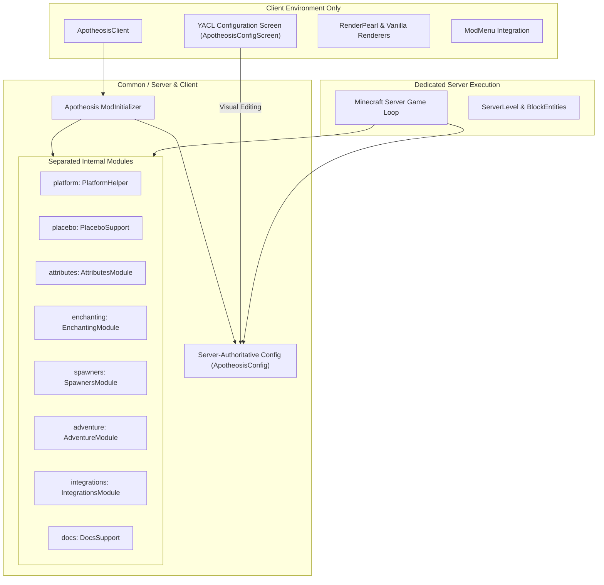
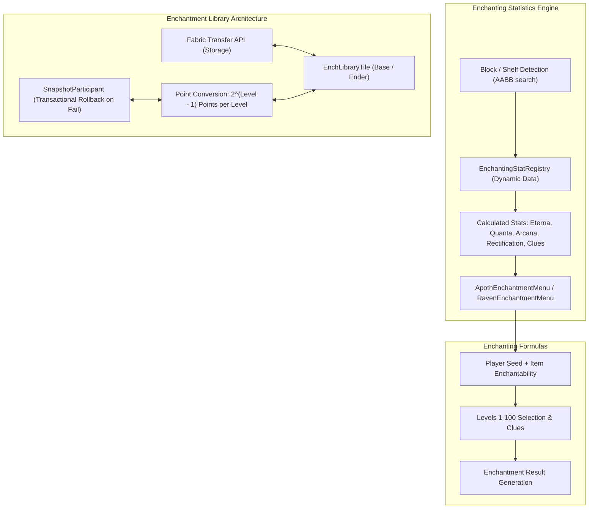
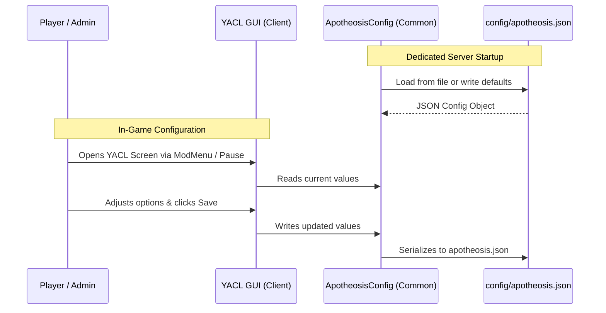

# System Architecture — Fabricated Apotheosis

## 1. High-Level System Architecture

Fabricated Apotheosis is engineered as a **single, unified Fabric distributable** for Minecraft 26.3 that consolidates the historically multi-jar NeoForge Apotheosis ecosystem into one cohesive mod artifact under mod ID `apotheosis`.

---

## 2. Internal Module Boundaries

The code is strictly partitioned into distinct internal packages to prevent architectural spaghetti while delivering a single combined JAR:

1. **`platform`** (`dev.shadowsoffire.apotheosis.platform`):
   - Isolates Fabric Loader specific calls, environment detection (`isClient()`, `isDedicatedServer()`), and platform abstractions.
2. **`placebo`** (`dev.shadowsoffire.apotheosis.placebo`):
   - Only the minimal, required utilities from upstream Placebo (codecs, dynamic registry wrappers, recipe helpers).
3. **`attributes`** (`dev.shadowsoffire.apothic_attributes`):
   - Registration of the 21 Apothic attributes, combat calculations, armor piercing, life steal, and attribute formatting.
   - 9-phase server-authoritative combat pipeline handling dodge, attack scaling, critical strikes, penetration, auxiliary damage, absorption, health damage, overheal/life steal, and experience scaling.
4. **`enchanting`** (`dev.shadowsoffire.apothic_enchanting`):
   - Table statistics engine (`EnchantmentTableStats`, `EnchantingStatRegistry`), supporting Eterna, Quanta, Arcana, Rectification, Clues, and Filtered stats across 30 block types.
   - Enchanting table menus (`ApothEnchantmentMenu`, `RavenEnchantmentMenu`) and level calculation formulas matching upstream.
   - Anvil overhaul (`AnvilMenuMixin`, `AnvilEvents`, `TomeItem`) removing level 40 caps, enabling optimal XP progression, and curse removal via Prismatic Web.
   - Enchantment Library (`EnchLibraryBlock`, `EnchLibraryTile`, `BasicLibraryTile`, `EnderLibraryTile`) with transactional $2^{N-1}$ point conversion and Fabric Transfer API (`Storage<ItemVariant>`).
   - 20 custom enchantments and 14 data-driven enchantment effect components.
5. **`spawners`** (`dev.shadowsoffire.apothic_spawners`):
   - Monster spawner modification, delay scaling, redstone controls, spawn conditions, and Silk Touch harvesting.
6. **`adventure`** (`dev.shadowsoffire.apotheosis.adventure`):
   - Affixes, gems, socketing, and boss mob generation.
7. **`client`** (`dev.shadowsoffire.apothic_attributes.client`, `dev.shadowsoffire.apothic_enchanting.client`, `dev.shadowsoffire.apotheosis.client`):
   - Client-only screens (`AttributesGui`, `ApothEnchantmentScreen`, `RavenEnchantmentScreen`, `EnchLibraryScreen`, `EnchantingInfoScreen`), tooltips, particle factories, keybindings, and rendering hooks.
8. **`integrations`** (`dev.shadowsoffire.apotheosis.integrations`):
   - Optional external mod hooks (Patchouli, ModMenu, Jade, EMI/JEI).
9. **`docs`** (`dev.shadowsoffire.apotheosis.docs`):
   - Guidebook integration and Chronicle of Shadows documentation structures.

---

## 3. Server Authority & Dedicated Server Safety

- **Authoritative Gameplay**: All spawner modifications, attribute calculations, loot determinations, and inventory interactions execute strictly on the logical server. The client only sends interaction packets or receives state synchronization.
- **Client Class Segregation**:
  - The project utilizes Loom's `splitEnvironmentSourceSets()`.
  - All classes referencing GUI, screens, YACL, Minecraft client classes, or rendering live strictly in `src/client/java`.
  - The dedicated server classpath NEVER loads client classes. Dedicated server launch has been verified with 100% clean startup and shutdown.

---

## 4. Apothic Enchanting Pipeline & Transactional Storage

---

## 4. Configuration Model

---

## 5. Rendering Architecture

- **High-Level Integration First**: Mod models, blocks, and items utilize Minecraft 26.3 native models (`assets/apotheosis/models/`) and block entity renderers.
- **RenderPearl Abstraction**: Where custom GPU blend states, custom shaders, or direct GPU buffers are required (e.g. boss health bars, gem socketing overlays), use Minecraft 26.3 public RenderPearl APIs.
- **No Raw GL/Vulkan Imports**: Avoid raw `GL11`, `GlStateManager`, or platform-specific backend classes to ensure cross-backend compatibility across OpenGL and Vulkan.
