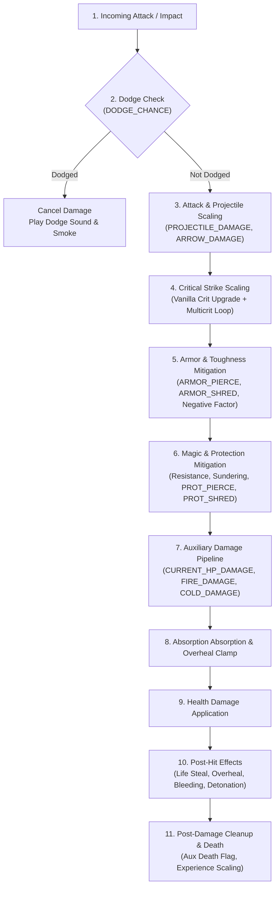

# Damage Processing Pipeline & Hook Mapping Specification

## Overview

This specification details the combat and damage processing pipeline ported from the pinned Minecraft 26.1.2 NeoForge Apothic Attributes baseline to Minecraft 26.3 Fabric. It defines the authoritative execution order, mathematical formulas, caps, bypass conditions, edge-case guards, and the mapping from original NeoForge events to targeted Fabric mixins.

---

## 1. Upstream Damage Processing Order

In the upstream NeoForge implementation, combat resolution follows a strictly ordered multi-stage pipeline:

### Stage 1: Dodge & Cancellation
- **Timing**: Earliest possible moment in the hit lifecycle (before invulnerability checks, shield absorption, or weapon durability damage).
- **Melee Check**:
  - Attacker is `Player`: target must be within `player.getAttributeValue(Attributes.ENTITY_INTERACTION_RANGE)`.
  - Attacker is `Mob`: target must be within `mob.isWithinMeleeAttackRange(target)`.
- **Projectile Check**: Triggered on projectile collision with a living entity (`EntityHitResult`).
- **Algorithm**:
  - Random seed computed via deterministic per-tick hash:
    $$\text{base} = \text{target.tickCount} + \text{target.getUUID().hashCode()}$$
    $$\text{seed} = \text{base} + \text{0x9E3779B9} + (\text{base} \ll 6) + (\text{base} \gg 2)$$
  - This ensures all damage instances hitting the entity within the same tick share the dodge outcome, preventing partial multi-instance attacks.
  - If $\text{rand.nextFloat()} \le \text{target.getAttributeValue(DODGE_CHANCE)}$:
    - Play `apothic_attributes:dodge` sound at pitch $0.7 + \text{rand} \times 0.3$.
    - Spawn 6 `LARGE_SMOKE` particles across entity bounding box.
    - Cancel incoming damage completely ($0$ damage, returns `false`).

### Stage 2: Attack & Projectile Scaling
- **Arrows**:
  - On entity join / spawn, guarded by persistent NBT flag `"apothic_attributes.arrow.done"`:
    $$\text{baseDamage} = \text{baseDamage} \times \text{owner.getAttributeValue(ARROW_DAMAGE)}$$
    $$\vec{v} = \vec{v} \times \text{owner.getAttributeValue(ARROW_VELOCITY)}$$
- **Generic Projectiles**:
  - If direct damage entity is `Projectile` and `projectile.getOwner()` is `LivingEntity`:
    $$\text{amount} = \text{amount} \times \text{owner.getAttributeValue(PROJECTILE_DAMAGE)}$$

### Stage 3: Critical Strikes & Multicrits
- **Vanilla Jump Crits**:
  - When vanilla evaluates a jump critical hit (`isCritical`), the standard $1.5\times$ damage multiplier is upgraded:
    $$\text{multiplier} = \max(\text{vanillaMultiplier}, \text{attacker.getAttributeValue(CRIT_DAMAGE)})$$
- **Apothic Critical Strike (Multicrit Loop)**:
  - If damage source is NOT tagged `#apothic_attributes:cannot_critically_strike`:
  - Fetch $\text{critChance} = \text{attacker.getAttributeValue(CRIT_CHANCE)}$ and $\text{critDmg} = \text{attacker.getAttributeValue(CRIT_DAMAGE)}$.
  - Loop while $\text{rand.nextFloat()} \le \text{critChance}$ and $\text{critDmg} > 1.0$:
    $$\text{damage} \mathrel{+}= \text{baseAmount} \times (\text{critDmg} - 1.0)$$
    $$\text{critDmg} \mathrel{*}= 0.85 \quad (\text{15\% degradation per additional crit tier})$$
    $$\text{critChance} \mathrel{-}= 1.0$$
  - If any crit occurred on server: broadcast `CritParticlePayload(target.getId())` to tracking players.

### Stage 4: Armor & Toughness Mitigation (`ALCombatRules.getDamageAfterArmor`)
- **Toughness Bypass Resistance**:
  - Toughness no longer directly reduces damage; instead, it resists armor pierce and shred:
    $$\text{bypassResist} = \min(0.02 \times \text{toughness}, 0.60)$$
- **Effective Armor Calculation**:
  $$\text{effectiveShred} = \text{armorShred} \times (1.0 - \text{bypassResist})$$
  $$\text{effectivePierce} = \text{armorPierce} \times (1.0 - \text{bypassResist})$$
  $$\text{armor}_{\text{eff}} = \text{armor} \times (1.0 - \text{effectiveShred}) - \text{effectivePierce}$$
- **Negative Armor Amplification**:
  - If $\text{armor}_{\text{eff}} \le 0$:
    $$\text{damage}_{\text{final}} = \text{damage} \times (1.0 + 0.015 \times (-\text{armor}_{\text{eff}}))$$
- **Positive Armor Reduction**:
  - If $\text{armor}_{\text{eff}} > 0$:
    $$A = \text{damage} < 20 ? 10 : 10 + \frac{\text{damage} - 20}{2}$$
    $$\text{reduction} = \frac{A}{A + \text{armor}_{\text{eff}}}$$
    $$\text{effectiveness} = \text{clamp}(\text{EnchantmentHelper.modifyArmorEffectiveness}(1 - \text{reduction}), 0.0, 1.0)$$
    $$\text{damage}_{\text{final}} = \text{damage} \times (1.0 - \text{effectiveness})$$

### Stage 5: Magic, Resistance, Sundering, & Protection (`ALCombatRules.getDamageAfterProtection`)
- **Resistance & Sundering**:
  - If target has `SUNDERING` mob effect and source is not `#minecraft:bypasses_resistance`:
    $$\text{sunderingBonus} = \text{damage} \times (\text{amplifier} + 1) \times 0.20$$
    Sundering directly offsets Resistance potion reduction or amplifies incoming damage if Resistance is absent.
- **Protection Bypass**:
  - Attacker protection shred & pierce applied:
    $$\text{prot}_{\text{eff}} = \text{protPoints} \times (1.0 - \text{protShred}) - \text{protPierce}$$
  - If $\text{prot}_{\text{eff}} \le 0$: damage unaffected.
  - If $\text{prot}_{\text{eff}} > 0$:
    $$\text{reductionFactor} = 1.0 - \min(0.025 \times \text{prot}_{\text{eff}}, 0.85)$$
    $$\text{damage}_{\text{final}} = \text{damage} \times \text{reductionFactor}$$

### Stage 6: Auxiliary Damage Pipeline (`AuxDmgTracker`)
- **Preconditions**: Server-side, non-reentrant (`noRecurse = true`), direct physical damage, attacker has attack strength $\ge 0.55$, target alive.
- **Damage Instances**:
  1. **Current HP Damage**:
     $$\text{damage} = \text{attacker.getAttributeValue(CURRENT_HP_DAMAGE)} \times \text{target.getHealth()}$$
     Damage type: `apothic_attributes:current_hp_damage`.
  2. **Fire Damage**:
     $$\text{damage} = \text{attacker.getAttributeValue(FIRE_DAMAGE)}$$
     Post-hit callback: $\text{fireTicks} \mathrel{+}= \lfloor 10 \times \text{damage} \rfloor$.
     Damage type: `apothic_attributes:fire_damage`.
  3. **Cold Damage**:
     $$\text{damage} = \text{attacker.getAttributeValue(COLD_DAMAGE)}$$
     Post-hit callback: applies `MobEffects.SLOWNESS` with duration $\min(150, \lfloor 15 \times \text{damage} \rfloor)$ and amplifier $\max(0, \lfloor \log_2(\text{round}(\text{damage}/5)) \rfloor)$.
     Damage type: `apothic_attributes:cold_damage`.
- **Sweep Attack Scaling**:
  - If target tagged `"apoth.hit_by_sweep_attack"` and attacker has `Attributes.SWEEPING_DAMAGE_RATIO`:
    $$\text{scaledDamage} = \min(\text{damage}, 1.0 + \text{ratio} \times \text{damage})$$
- **Auxiliary Kill Guard**:
  - If target dies during auxiliary attacks:
    - Set target persistent tag `"apoth.killed_by_aux_dmg" = true`.
    - Cancel primary damage execution to prevent duplicate `die(DamageSource)` calls and duplicate loot/XP drops.

### Stage 7: Absorption & Health Damage
- Target's absorption absorbs damage first:
  $$\text{absorbed} = \min(\text{target.getAbsorptionAmount()}, \text{damage})$$
  $$\text{damageRem} = \text{damage} - \text{absorbed}$$
  $$\text{target.setAbsorptionAmount}(\text{target.getAbsorptionAmount()} - \text{absorbed})$$
- Remaining damage reduces health:
  $$\text{healthDamage} = \min(\text{target.getHealth()}, \text{damageRem})$$
  $$\text{target.setHealth}(\text{target.getHealth()} - \text{healthDamage})$$

### Stage 8: Post-Hit Effects (Life Steal & Overheal)
- **Preconditions**: Attacker is `LivingEntity`, attack is physical (`isPhysicalDamage(src)`).
- **Life Steal**:
  $$\text{healAmount} = \text{healthDamage} \times \text{attacker.getAttributeValue(LIFE_STEAL)}$$
  If $\text{healAmount} > 0.001$: $\text{attacker.heal}(\text{healAmount})$.
- **Overheal**:
  - Overheal cap: $\text{cap} = \text{attacker.getMaxHealth()} \times 0.50$.
  - Current absorption: $\text{current} = \text{attacker.getAbsorptionAmount()}$.
  - If $\text{current} < \text{cap}$:
    $$\text{gain} = \min(\text{cap} - \text{current}, \text{healthDamage} \times \text{attacker.getAttributeValue(OVERHEAL)})$$
    $$\text{newOverheal} = \text{getOverhealAbsorption(attacker)} + \text{gain}$$
    Store $\text{newOverheal}$ in attachment, update absorption via un-clamped internal setter.

### Stage 9: Healing & Experience Processing
- **Healing Received**:
  $$\text{effectiveHeal} = \text{amount} \times \text{entity.getAttributeValue(HEALING_RECEIVED)}$$
  If $\text{effectiveHeal} \le 0$: cancel healing.
- **Experience Gained**:
  - Block break & mob death XP scaled:
    $$\text{xp}_{\text{dropped}} = \lfloor \text{xp} \times \text{player.getAttributeValue(EXPERIENCE_GAINED)} \rfloor$$

---

## 2. Mapping from NeoForge Events to Fabric Mixins / Hooks

| Original NeoForge Hook | Priority | Fabric Implementation Target | Technique |
| :--- | :--- | :--- | :--- |
| `LivingIncomingDamageEvent` (Dodge) | `HIGH` | `LivingEntity.hurtServer` (Head) & `AbstractArrow.onHitEntity` | Targeted `@Inject(at = @At("HEAD"), cancellable = true)` |
| `LivingIncomingDamageEvent` (Proj Dmg) | `HIGHEST` | `LivingEntity.hurtServer` (Head, argsOnly) | `@ModifyVariable(method = "hurtServer", at = @At("HEAD"), argsOnly = true)` |
| `EntityJoinLevelEvent` (Arrow Dmg/Vel) | `NORMAL` | `AbstractArrow.shoot` / constructor / `ServerLevel.addFreshEntity` | Mixin into `AbstractArrow` with persistent flag check |
| `CriticalHitEvent` (Vanilla Crit) | `HIGH` | `Player.attack` (crit multiplier) | `@ModifyConstant` or `@ModifyExpressionValue` in `Player.attack` |
| `LivingIncomingDamageEvent` (Apoth Crit) | `HIGH` | `LivingEntity.hurtServer` / `Player.attack` | Mixin scaling damage and dispatching `CritParticlePayload` |
| `CombatRules.getDamageAfterAbsorb` | `OVERWRITE` | `CombatRules.getDamageAfterAbsorb` | Mixin `@Overwrite` / `@Inject` delegating to `ALCombatRules.getDamageAfterArmor` |
| `CombatRules.getDamageAfterMagicAbsorb` | `OVERWRITE` | `CombatRules.getDamageAfterMagicAbsorb` | Mixin delegating to `ALCombatRules.getProtDamageReduction` |
| `LivingEntity.getDamageAfterMagicAbsorb` | `REDIRECT` | `LivingEntity.getDamageAfterMagicAbsorb` | Mixin injecting Sundering bonus and `ALCombatRules.getDamageAfterProtection` |
| `LivingIncomingDamageEvent` (Aux Melee) | `LOWEST` | `LivingEntity.hurtServer` (before actuallyHurt or in hurtServer tail) | Mixin invoking `AuxDmgTracker` with non-reentrant guard |
| `LivingDamageEvent.Pre` / `Post` (Life Steal/Overheal)| `LOWEST` / `NORMAL` | `LivingEntity.actuallyHurt` (wrapping health reduction) | Mixin capturing pre-damage health and applying lifesteal/overheal at tail |
| `LivingHealEvent` | `HIGH` | `LivingEntity.heal` (Head) | Targeted `@ModifyVariable(argsOnly = true)` and cancel if $\le 0$ |
| `LivingExperienceDropEvent` | `HIGH` | `LivingEntity.dropExperience` | `@ModifyVariable` scaling dropped XP by `EXPERIENCE_GAINED` |
| `BlockDropsEvent` | `HIGH` | `Block.popExperience` | Mixin scaling experience by breaker's `EXPERIENCE_GAINED` |
| `LivingEntityUseItemEvent.Tick` | `NORMAL` | `LivingEntity.updatingUsingItem` | Targeted injection adjusting use duration by `DRAW_SPEED` |
| Elytra flight hooks | `OVERWRITE` | `LivingEntity.canGlide`, `canGlideUsing`, `updateFallFlying` | Targeted mixins matching upstream `LivingEntityMixin` |
| Fall damage gravity hook | `NORMAL` | `Entity.checkFallDamage` | `@ModifyVariable` scaling yMotion by `gravity / 0.08` |
| Sneak edge clamp | `NORMAL` | `Player.maybeBackOffFromEdge` | `@WrapOperation` clamping step-down to $0.6\text{F}$ |

---

## 3. Recursion & Safety Guards

1. **Non-Reentrant Auxiliary Damage (`noRecurse`)**:
   Auxiliary attacks (`CURRENT_HP_DAMAGE`, `FIRE_DAMAGE`, `COLD_DAMAGE`) trigger `hurtServer` on the target. Without a strict reentrancy guard, these attacks would recursively trigger another round of auxiliary attacks. A static `boolean noRecurse` ensures that aux attacks never trigger subsequent aux damage.
2. **Preventing Double Death & Duplicate Loot (`apoth.killed_by_aux_dmg`)**:
   If an auxiliary attack reduces the target's health to 0, `die(DamageSource)` is executed by the auxiliary attack. The primary attack is canceled, and the target is tagged with `"apoth.killed_by_aux_dmg" = true`. `Player.attack` inspects this flag so that follow-up effects (such as sweep attacks) proceed normally without triggering a second death sequence.
3. **Overheal Absorption Clamping**:
   Overheal absorption must never overwrite or destroy other sources of absorption (e.g. Golden Apple, Absorption effect). The tracked overheal absorption in the entity attachment is capped at $50\%$ of max health and clamped to the entity's actual current absorption amount on every absorption reduction.
4. **Projectile Re-scaling Prevention**:
   Arrows scale `baseDamage` and velocity exactly once using the persistent boolean tag `"apothic_attributes.arrow.done"`. Chunk reloading or world saves cannot cause arrows to re-multiply their damage.
